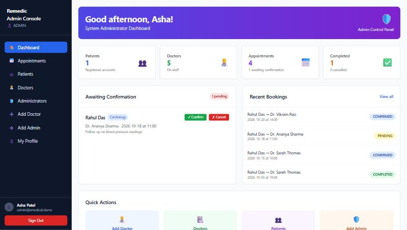
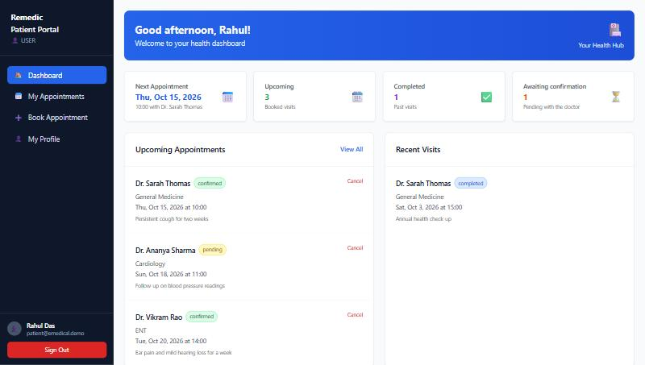
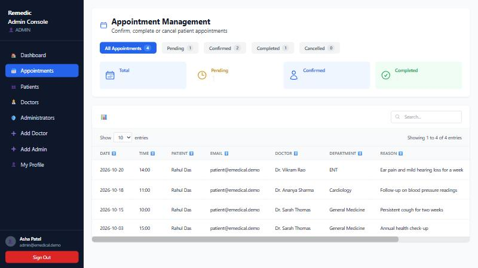
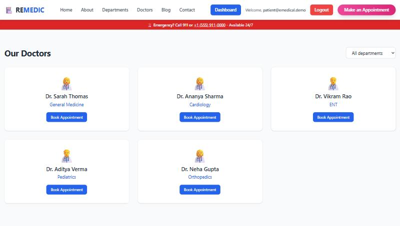

# E-Medical System

A hospital appointment platform where **patients** book doctors, **doctors** manage their schedule and **administrators** run the clinic. Spring Boot REST API secured with JWT, React single-page front end, one Docker image, deployed with a managed database.

[](https://github.com/TusharKhangar/E---MEdical/actions/workflows/maven.yml)


**Live demo:** <https://e-medical-224w.onrender.com> (free tier, the first visit can take a minute to wake up) · sign in with the [demo accounts](#demo-accounts)

| Admin console | Patient dashboard |
| --- | --- |
|  |  |

| Appointment management | Doctor directory |
| --- | --- |
|  |  |

## What it does

- **Patients** register with their e-mail, confirm it through a one-time link, choose a password, browse doctors by department, see free half-hour slots and book. They can track and cancel their appointments.
- **Doctors** see the appointments booked with them, confirm, complete or cancel each one, and keep their profile and specialization up to date.
- **Administrators** get live counts, confirm bookings on behalf of doctors, manage every appointment, list patients, doctors and admins, enable or disable accounts, and onboard new staff, who receive an e-mail link to set their own password.
- **Everyone** can change their password; forgotten passwords are reset through an e-mailed, single-use link.

Business rules live in the service layer: slots are 09:00 to 17:00 on the hour (closed 13:00 to 14:00), no double booking per doctor, no bookings in the past or more than 90 days ahead, and status moves only `PENDING → CONFIRMED → COMPLETED` or to `CANCELLED`.

## Architecture

```
Browser ──► React 18 + Vite + Tailwind (Frontend/medical-frontend)
               │  JSON over /api, Bearer JWT in the Authorization header
               ▼
         Spring Boot 3.2 (bioMedical)
         ├─ Spring Security 6 · stateless JWT filter · role rules per URL
         ├─ Controllers → Services → Spring Data JPA repositories (HQL for slot checks)
         ├─ Bean Validation on every request body, plain-text error responses
         └─ JavaMail for confirmation, invitation and reset e-mails (optional)
               │
               ▼
         MySQL 8 (local) or PostgreSQL (Render)
```

In production the React build is packaged inside the Spring Boot jar and served from the same origin, so there is a single container, a single port and no CORS to configure.

## Tech stack

| Layer | Technology |
| --- | --- |
| Backend | Java 21, Spring Boot 3.2, Spring Security, Spring Data JPA / Hibernate, Bean Validation, JJWT, zxcvbn password strength, Spring Mail, Actuator |
| Frontend | React 18, React Router 6, Vite 5, Tailwind CSS, Axios, Framer Motion, react-hot-toast |
| Database | MySQL 8 or PostgreSQL 16 (H2 in-memory for tests) |
| Delivery | Docker multi-stage build, docker-compose, GitHub Actions CI, Render blueprint |
| Tests | JUnit 5, MockMvc web-layer tests, Spring Boot integration tests on H2 (19 tests) |

## Run it locally

### Option A: Docker (nothing to install but Docker)

```bash
docker compose up --build
```

Open <http://localhost:8080>. MySQL runs in a second container, demo accounts are created on first start and the sign-in page lists them.

### Option B: from source

Requirements: JDK 21, Node 20, MySQL 8 with a database named `userauth`.

```bash
cp .env.example .env            # fill in DB_PASSWORD, JWT_SECRET and (optionally) Gmail credentials
cd bioMedical && ./mvnw spring-boot:run
```

In a second terminal:

```bash
cd Frontend/medical-frontend
npm install
npm run dev                     # http://localhost:5173, proxies /api to :8080
```

Set `SEED_DEMO_DATA=true` in `.env` to get the demo accounts on an empty database.

### Demo accounts

| Role | E-mail | Password |
| --- | --- | --- |
| Administrator | `admin@emedical.demo` | `Demo@Clinic2025` |
| Doctor | `doctor@emedical.demo` | `Demo@Clinic2025` |
| Patient | `patient@emedical.demo` | `Demo@Clinic2025` |

### E-mail

Registration, staff invitations and password resets send a link by e-mail. Without `MAIL_USERNAME` / `MAIL_PASSWORD` the message is written to the application log instead, link included, so every flow still works offline. For Gmail use an [app password](https://support.google.com/accounts/answer/185833), not your account password.

## Configuration

All settings come from environment variables (see [`.env.example`](.env.example)).

| Variable | Purpose | Default |
| --- | --- | --- |
| `DB_URL` | Full JDBC URL, or set `DB_VENDOR`, `DB_HOST`, `DB_PORT`, `DB_NAME` separately | `jdbc:mysql://localhost:3306/userauth` |
| `DB_USERNAME`, `DB_PASSWORD` | Database credentials | `root`, empty |
| `JWT_SECRET` | Base64 HMAC key, at least 256 bits (`openssl rand -base64 32`) | required |
| `JWT_EXPIRATION` | Token lifetime in ms | 24 h |
| `MAIL_USERNAME`, `MAIL_PASSWORD` | SMTP account (Gmail by default) | empty = log only |
| `FRONTEND_URL` | Base URL used in e-mailed links | `http://localhost:5173` |
| `CORS_ALLOWED_ORIGINS` | Browser origins allowed to call the API cross-origin | localhost dev ports |
| `SEED_DEMO_DATA` | Create demo accounts on an empty database | `false` |
| `PORT` | HTTP port | `8080` |

## API

All endpoints are under `/api`. Protected ones need `Authorization: Bearer <jwt>`.

| Method | Path | Who | What |
| --- | --- | --- | --- |
| POST | `/register` | public | Patient sign-up, sends confirmation e-mail |
| GET | `/confirm?token=` | public | Check a confirmation link |
| POST | `/confirmPassword` | public | Choose password from a link, enables the account |
| POST | `/login` | public | Returns JWT plus id, name and role |
| POST | `/forgotPassword` | public | Sends a reset link (same reply whether or not the e-mail exists) |
| POST | `/resetPassword` | public | Sets a new password from a reset link |
| GET | `/doctors?specialization=` | public | Active doctors |
| GET | `/doctors/{id}/slots?date=` | public | Free slots for a day |
| GET, PUT | `/profile` | any role | Read or update own profile |
| PUT | `/profile/password` | any role | Change password |
| GET, POST | `/user/appointments` | patient | List own or book |
| PATCH | `/user/appointments/{id}/cancel` | patient | Cancel own |
| GET | `/doctor/appointments` | doctor | Appointments booked with me |
| PATCH | `/doctor/appointments/{id}/status` | doctor | Confirm, complete or cancel |
| GET | `/admin/stats` | admin | Dashboard counts |
| GET | `/admin/users`, `/admin/doctors`, `/admin/admins` | admin | Account lists |
| POST | `/admin/doctors`, `/admin/admins` | admin | Invite staff by e-mail |
| PATCH | `/admin/users/{id}/enabled` | admin | Enable or disable an account |
| GET | `/admin/appointments` | admin | Every appointment |
| PATCH | `/admin/appointments/{id}/status` | admin | Change any appointment |

Errors are returned as plain text with a matching HTTP status (`400` validation, `401` sign-in needed, `403` wrong role, `404` not found, `409` conflict such as a taken slot).

## Tests

```bash
cd bioMedical && ./mvnw test
```

- `RegisterControllerTest`: web-layer tests for sign-up and confirmation with the real security filter chain.
- `AppointmentFlowIntegrationTest`: full HTTP flows on an in-memory database: register → confirm → log in, admin invites a doctor who sets a password, booking with slot conflicts and validation, who may cancel what, role enforcement, forgot/reset password, profile update.

CI runs the backend tests, the frontend lint and build, and a Docker image build on every push.

## Deploy

The repository contains a [`render.yaml`](render.yaml) blueprint for [Render](https://render.com): a free web service built from the `Dockerfile` and a free PostgreSQL database, with every environment variable wired up. Pick **New → Blueprint** in Render, select the repository, and after the first deploy set `FRONTEND_URL` and `CORS_ALLOWED_ORIGINS` to the URL Render assigned.

Any host that runs a Docker image works the same way: build the image, point `DB_*` at a database, set `JWT_SECRET`.

## Project layout

```
bioMedical/                      Spring Boot API
  src/main/java/com/spring/bioMedical/
    Controller/   REST endpoints by role (Register, Login, ResetPassword, User, Doctor, Admin, Profile, Public)
    service/      business rules (booking, status changes, e-mail, password strength)
    repository/   Spring Data JPA repositories with HQL slot queries
    entity/       User (all roles) and Appointment
    dto/          request and response bodies with validation
    security/     JWT creation and filter
    config/       Spring Security, user details, demo data seeder
  src/test/java/                 web-layer and integration tests
Frontend/medical-frontend/       React app (Vite)
  src/pages/         public pages, booking, auth flows
  src/components/    dashboards per role, appointment tables, forms
  src/services/      api.js (axios + JWT), authService.js, medicalService.js (every endpoint)
Dockerfile, docker-compose.yml, render.yaml, .github/workflows/maven.yml
```

## Security notes

- Passwords are BCrypt-hashed; confirmation and reset tokens are random UUIDs, single-use, and never returned by the API.
- JWTs are HS256-signed with a secret from the environment; the API is stateless with CSRF disabled.
- Password hashes, tokens and other people's contact details are never serialized; the public doctor list hides e-mail and phone.
- Password strength is measured with zxcvbn (score ≥ 3), not just length.
- Secrets live in environment variables; `.env` is git-ignored.

## License

Apache 2.0, see [LICENSE](LICENSE).
