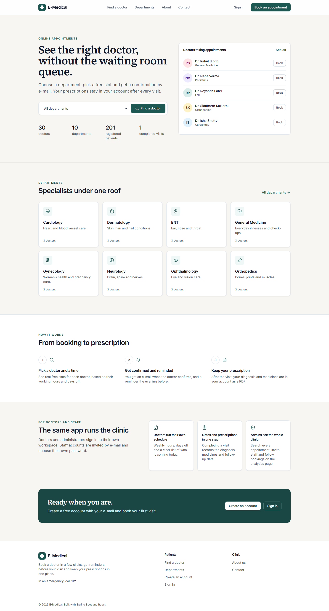
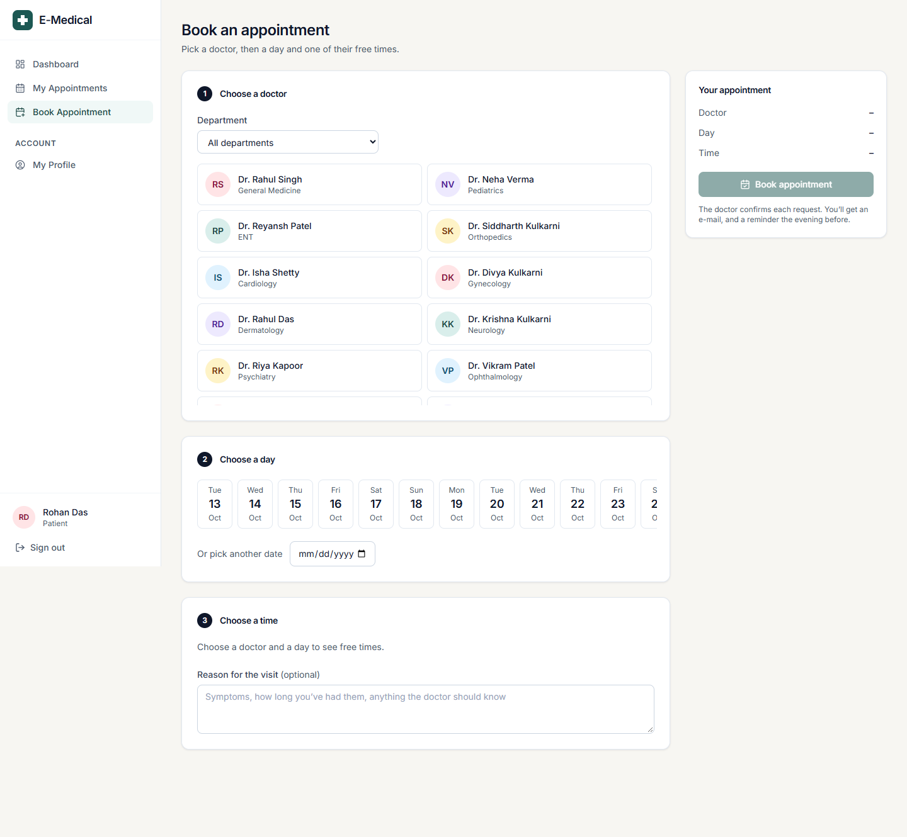
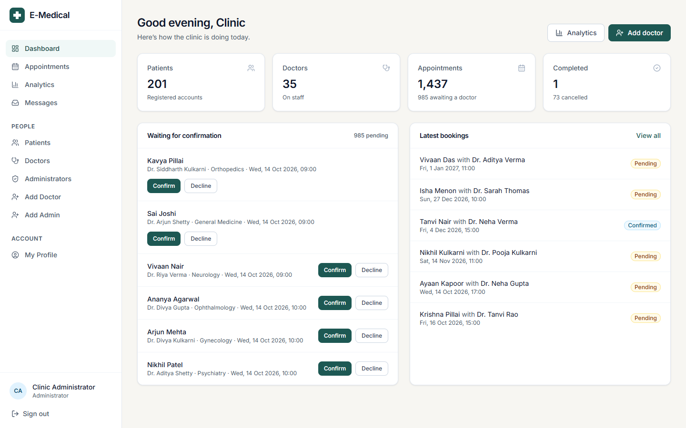
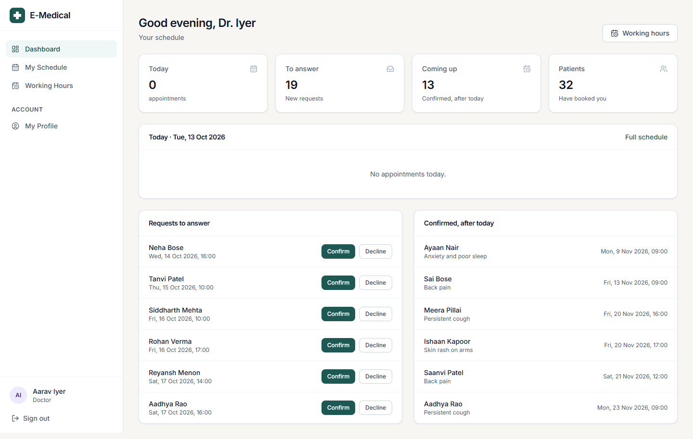
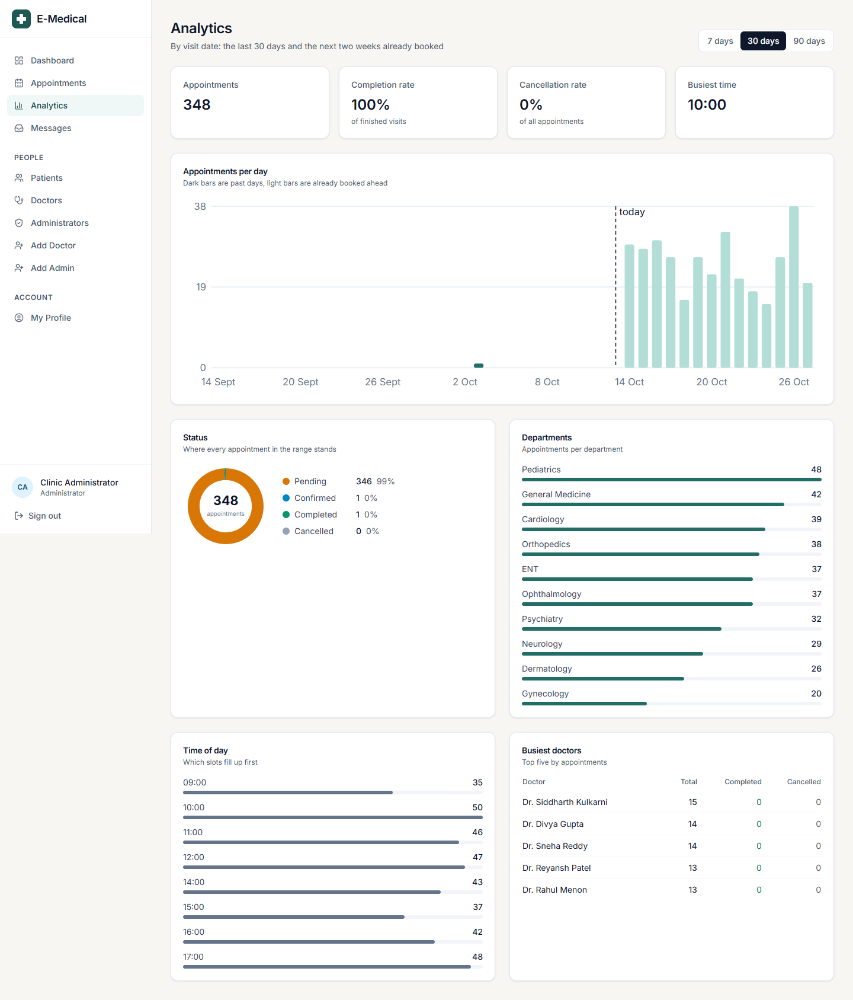
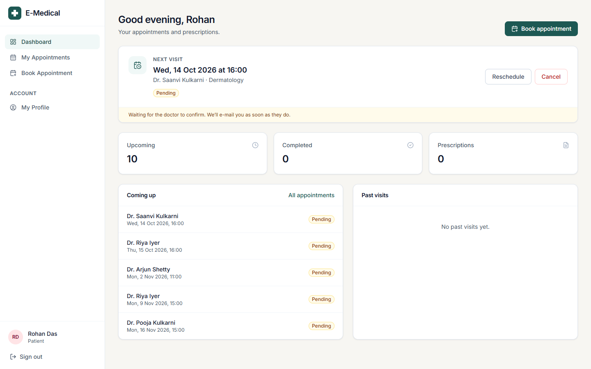
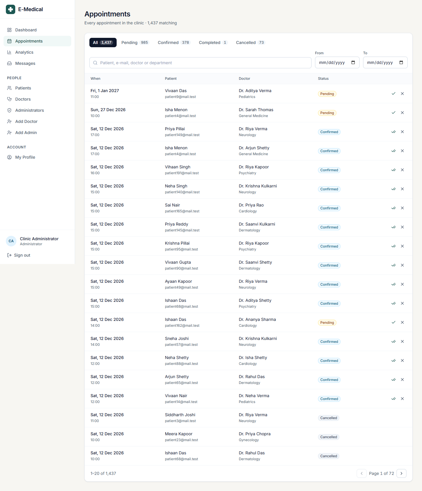
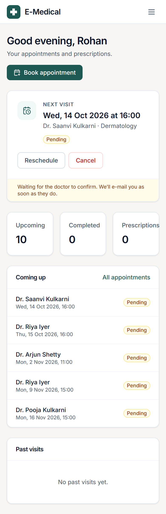

# E-Medical System

A hospital appointment platform where **patients** book doctors, **doctors** manage their schedule and **administrators** run the clinic. Spring Boot REST API secured with JWT, React single-page front end, one Docker image, deployed with a managed database.

[](https://github.com/TusharKhangar/E---MEdical/actions/workflows/maven.yml)


**Live:** <https://e-medical-224w.onrender.com> (free tier, the first visit can take a minute to wake up) · register as a patient with your own e-mail · **API docs:** [Swagger UI](https://e-medical-224w.onrender.com/swagger-ui.html)



| Booking | Admin console |
| --- | --- |
|  |  |

| Doctor's day | Analytics |
| --- | --- |
|  |  |

| Patient dashboard | Appointment search | On a phone |
| --- | --- | --- |
|  |  |  |

## What it does

- **Patients** register with their e-mail, confirm it through a one-time link, choose a password, browse doctors by department, see free hourly slots and book. They can track, reschedule and cancel appointments, and view or download their prescription as a PDF after the visit.
- **Doctors** set their weekly working hours and days off, confirm or cancel the appointments booked with them, and complete a visit by writing notes and a prescription (diagnosis, medicines, follow-up date).
- **Administrators** get live counts and an analytics page (bookings per day, status mix, departments, busiest slots and doctors), search and page through every appointment and account on the server, confirm bookings on behalf of doctors, manage every appointment, list patients, doctors and admins, enable or disable accounts, and onboard new staff, who receive an e-mail link to set their own password.
- **E-mails** go out when an appointment is booked, confirmed, moved, cancelled or completed, and a scheduled job reminds each patient the evening before their visit (once per appointment, even across restarts).
- **Everyone** can change their password; forgotten passwords are reset through an e-mailed, single-use link.
- **Visitors** browse live departments and doctors, see real clinic numbers on the home page, and send messages through the Contact page, which land in an admin inbox.

Business rules live in the service layer: slots follow each doctor's working hours (09:00 to 18:00 with a 13:00 lunch break by default) and skip their days off, a doctor can't take a day off that still has appointments, no double booking per doctor (enforced with row locks, so two people clicking the same slot at once can't both get it), no patient booked twice at the same time, no bookings in the past or more than 90 days ahead, and status moves only `PENDING → CONFIRMED → COMPLETED` or to `CANCELLED`. Five wrong passwords lock an e-mail for 15 minutes.

## Architecture

```
Browser ──► React 18 + Vite + Tailwind (Frontend/medical-frontend)
               │  JSON over /api, Bearer JWT in the Authorization header
               ▼
         Spring Boot 3.2 (bioMedical)
         ├─ Spring Security 6 · stateless JWT filter · role rules per URL
         ├─ Controllers → Services → Spring Data JPA repositories (HQL for slot checks)
         ├─ Bean Validation on every request body, plain-text error responses
         └─ JavaMail for confirmation, invitation and reset e-mails (optional)
               │
               ▼
         MySQL 8 (local) or PostgreSQL (Render)
```

In production the React build is packaged inside the Spring Boot jar and served from the same origin, so there is a single container, a single port and no CORS to configure.

## Tech stack

| Layer | Technology |
| --- | --- |
| Backend | Java 21, Spring Boot 3.2, Spring Security, Spring Data JPA / Hibernate, Bean Validation, JJWT, zxcvbn password strength, Spring Mail, Actuator |
| Frontend | React 18, React Router 6, Vite 5, Tailwind CSS, Lucide icons, Axios, react-hot-toast |
| Database | MySQL 8 or PostgreSQL 16 (H2 in-memory for tests) |
| Delivery | Docker multi-stage build, docker-compose, GitHub Actions CI, Render blueprint, OpenAPI / Swagger UI |
| Tests | JUnit 5, MockMvc, Spring Boot integration tests on H2 (53 tests); Vitest + Testing Library (17 tests); Playwright browser tests (35) |

## Run it locally

### Option A: Docker (nothing to install but Docker)

```bash
docker compose up --build
```

Open <http://localhost:8080>. MySQL runs in a second container. Set `ADMIN_EMAIL` and `ADMIN_PASSWORD` in `.env` first; that administrator is created on first start.

### Option B: from source

Requirements: JDK 21, Node 20, MySQL 8 with a database named `userauth`.

```bash
cp .env.example .env            # fill in DB_PASSWORD, JWT_SECRET and (optionally) Gmail credentials
cd bioMedical && ./mvnw spring-boot:run
```

In a second terminal:

```bash
cd Frontend/medical-frontend
npm install
npm run dev                     # http://localhost:5173, proxies /api to :8080
```

### First administrator

Set `ADMIN_EMAIL` and `ADMIN_PASSWORD` (environment or `.env`). On startup the app creates that administrator if the e-mail has no account yet, and never changes an existing account. The administrator then invites doctors and other admins by e-mail; patients register themselves.

### E-mail

Registration, staff invitations, password resets and appointment updates are sent by e-mail, in this order of preference:

1. **Brevo HTTPS API** (`BREVO_API_KEY` and a verified sender in `MAIL_FROM`). Use this on Render's free plan, which blocks outgoing SMTP ports 25, 465 and 587.
2. **SMTP** (`MAIL_USERNAME` / `MAIL_PASSWORD`, Gmail by default; use an [app password](https://support.google.com/accounts/answer/185833)).
3. Neither set: the message is written to the application log, link included, so local development works offline.

The startup log says which one is active (`E-mail delivery: brevo | smtp | log-only`), and the admin dashboard shows it with a **Send me a test e-mail** button that reports the provider's answer.

## Configuration

All settings come from environment variables (see [`.env.example`](.env.example)).

| Variable | Purpose | Default |
| --- | --- | --- |
| `DB_URL` | Full JDBC URL, or set `DB_VENDOR`, `DB_HOST`, `DB_PORT`, `DB_NAME` separately | `jdbc:mysql://localhost:3306/userauth` |
| `DB_USERNAME`, `DB_PASSWORD` | Database credentials | `root`, empty |
| `JWT_SECRET` | Base64 HMAC key, at least 256 bits (`openssl rand -base64 32`) | required |
| `JWT_EXPIRATION` | Token lifetime in ms | 24 h |
| `MAIL_USERNAME`, `MAIL_PASSWORD` | SMTP account (Gmail by default) | empty = log only |
| `FRONTEND_URL` | Base URL used in e-mailed links | `http://localhost:5173` |
| `CORS_ALLOWED_ORIGINS` | Browser origins allowed to call the API cross-origin | localhost dev ports |
| `ADMIN_EMAIL`, `ADMIN_PASSWORD` | First administrator, created on startup if new | empty |
| `BREVO_API_KEY`, `MAIL_FROM`, `MAIL_FROM_NAME` | E-mail over Brevo's HTTPS API (takes priority over SMTP) | empty, `MAIL_USERNAME`, `E-Medical` |
| `LOGIN_MAX_FAILURES`, `LOGIN_LOCK_MINUTES` | Sign-in lockout | `5`, `15` |
| `REMINDERS_ENABLED`, `REMINDERS_CRON`, `APP_TIME_ZONE` | Day-before reminder e-mails | `true`, `0 0 18 * * *`, `Asia/Kolkata` |
| `PORT` | HTTP port | `8080` |

## API

All endpoints are under `/api`. Protected ones need `Authorization: Bearer <jwt>`.

| Method | Path | Who | What |
| --- | --- | --- | --- |
| POST | `/register` | public | Patient sign-up, sends confirmation e-mail |
| GET | `/confirm?token=` | public | Check a confirmation link |
| POST | `/confirmPassword` | public | Choose password from a link, enables the account |
| POST | `/login` | public | Returns JWT plus id, name and role |
| POST | `/forgotPassword` | public | Sends a reset link (same reply whether or not the e-mail exists) |
| POST | `/resetPassword` | public | Sets a new password from a reset link |
| GET | `/doctors?specialization=` | public | Active doctors |
| GET | `/doctors/{id}/slots?date=` | public | Free slots for a day |
| GET, PUT | `/profile` | any role | Read or update own profile |
| PUT | `/profile/password` | any role | Change password |
| GET, POST | `/user/appointments` | patient | List own or book |
| PATCH | `/user/appointments/{id}/cancel` | patient | Cancel own |
| PATCH | `/user/appointments/{id}/reschedule` | patient | Move to another free slot |
| GET | `/doctor/appointments` | doctor | Appointments booked with me |
| PATCH | `/doctor/appointments/{id}/status` | doctor | Confirm, complete or cancel |
| GET, PUT | `/doctor/schedule` | doctor | Weekly working hours |
| GET, POST, DELETE | `/doctor/leave`, `/doctor/leave/{id}` | doctor | Days off |
| GET, PUT | `/appointments/{id}/prescription` | patient, doctor, admin (PUT: doctor) | Visit notes and prescription |
| GET | `/appointments/{id}/prescription/pdf` | patient, doctor, admin | Prescription as a PDF |
| GET | `/admin/stats` | admin | Dashboard counts |
| GET | `/admin/analytics?days=30` | admin | Grouped numbers for the charts |
| GET, POST | `/admin/mail`, `/admin/mail/test` | admin | How e-mail is delivered; send yourself a test e-mail |
| GET | `/admin/appointments/search?q=&status=&doctorId=&from=&to=&sort=&page=&size=` | admin | Server-side search and paging |
| GET | `/admin/accounts?role=USER\|DOCTOR\|ADMIN&q=&page=&size=` | admin | Server-side account search |
| GET | `/admin/users`, `/admin/doctors`, `/admin/admins` | admin | Account lists |
| POST | `/admin/doctors`, `/admin/admins` | admin | Invite staff by e-mail |
| PATCH | `/admin/users/{id}/enabled` | admin | Enable or disable an account |
| GET | `/admin/appointments` | admin | Every appointment |
| PATCH | `/admin/appointments/{id}/status` | admin | Change any appointment |
| GET, PATCH | `/admin/messages`, `/admin/messages/{id}` | admin | Contact-page inbox, mark handled |
| GET | `/stats` | public | Headline numbers for the home page |
| POST | `/contact` | public | Send a message (3 per e-mail per hour) |

Errors are returned as plain text with a matching HTTP status (`400` validation, `401` sign-in needed, `403` wrong role, `404` not found, `409` conflict such as a taken slot, `429` too many attempts). The interactive reference is at `/swagger-ui.html`; click **Authorize** and paste the `jwt` from `/api/login`.

## Tests

```bash
cd bioMedical && ./mvnw test            # 65 backend tests
cd Frontend/medical-frontend && npm test  # 17 frontend tests (Vitest + Testing Library)
cd Frontend/medical-frontend && npm run e2e  # 35 browser tests (Playwright) against the built jar
```

Backend:
- `RegisterControllerTest`: web-layer tests for sign-up and confirmation with the real security filter chain.
- `AppointmentFlowIntegrationTest`: full HTTP flows on an in-memory database: register → confirm → log in, admin invites a doctor who sets a password, booking with slot conflicts and validation, who may cancel what, role enforcement, forgot/reset password, profile update.
- `HardeningIntegrationTest`: error codes (400/401/403/404), a patient can't be booked twice at once, login lockout, contact form and its rate limit, public stats, OpenAPI docs and security headers.
- `ConcurrentBookingIntegrationTest`: 20 threads book the same slot at once; exactly one wins.
- `ScheduleIntegrationTest`, `PrescriptionIntegrationTest`, `NotificationIntegrationTest`, `AdminInsightsIntegrationTest`: working hours and days off, rescheduling, prescriptions and their PDF, who may read them, which e-mail goes to whom, reminders sent once, analytics numbers and server-side search.
- `AccountSetupIntegrationTest`, `EmailServiceTest` and `LoginAttemptServiceTest`: first-admin creation, retiring the old demo accounts, the Brevo request and its failure handling, lockout window with a controllable clock.

Frontend: the server-side pager, route guarding by role, the role-aware sidebar, the API error and role helpers, and department grouping.

Browser (Playwright, `Frontend/medical-frontend/e2e/`, run by CI against the real jar on an in-memory database with e-mail in log-only mode): sign-up through the e-mailed link, sign-in, sign-out and password reset; an admin invites a doctor, the doctor sets hours and a day off, a patient books and reschedules, the doctor confirms and writes a prescription, the patient downloads the PDF; role guards, forged and expired tokens, cross-patient access, security headers; axe accessibility checks on every page for every role; no side-scrolling on a phone. `tools/loadtest.mjs` fills a local instance with realistic data and measures every endpoint.

CI runs the backend tests, the frontend lint, tests and build, and a Docker image build on every push.

## Deploy

The repository contains a [`render.yaml`](render.yaml) blueprint for [Render](https://render.com): a free web service built from the `Dockerfile` and a free PostgreSQL database, with every environment variable wired up. Pick **New → Blueprint** in Render, select the repository, and after the first deploy set `FRONTEND_URL` and `CORS_ALLOWED_ORIGINS` to the URL Render assigned.

Any host that runs a Docker image works the same way: build the image, point `DB_*` at a database, set `JWT_SECRET`.

## Project layout

```
bioMedical/                      Spring Boot API
  src/main/java/com/spring/bioMedical/
    Controller/   REST endpoints by role (Register, Login, ResetPassword, User, Doctor, Admin, Profile, Public)
    service/      business rules (booking, status changes, e-mail, password strength)
    repository/   Spring Data JPA repositories with HQL slot queries
    entity/       User (all roles) and Appointment
    dto/          request and response bodies with validation
    security/     JWT creation and filter
    config/       Spring Security, user details, first-admin setup
  src/test/java/                 web-layer and integration tests
Frontend/medical-frontend/       React app (Vite)
  src/pages/         public pages, booking, auth flows
  src/components/    dashboards per role, appointment tables, forms
  src/services/      api.js (axios + JWT), authService.js, medicalService.js (every endpoint)
Dockerfile, docker-compose.yml, render.yaml, .github/workflows/maven.yml
```

## Security notes

- Passwords are BCrypt-hashed; confirmation and reset tokens are random UUIDs, single-use, and never returned by the API.
- JWTs are HS256-signed with a secret from the environment; the API is stateless with CSRF disabled.
- Password hashes, tokens and other people's contact details are never serialized; the public doctor list hides e-mail and phone.
- Password strength is measured with zxcvbn (score ≥ 3), not just length.
- Five failed sign-ins lock the e-mail for 15 minutes; the contact form is limited per sender.
- `Content-Security-Policy`, `Referrer-Policy`, `Permissions-Policy`, HSTS, `X-Content-Type-Options` and frame options are set on every response.
- Secrets live in environment variables; `.env` is git-ignored.

## License

Apache 2.0, see [LICENSE](LICENSE).
